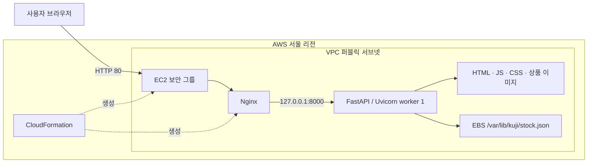

# KUJI POP

캐릭터 상품을 선택하고 남은 실제 티켓에서 무작위 경품을 뽑는 학습용 웹 서비스입니다. HTML/CSS/JavaScript와 Python FastAPI를 사용합니다. 결제·회원 인증은 구현하지 않았으며 실제 금전 거래 서비스가 아닙니다.

## 배포 상태

AWS 서울 리전(`ap-northeast-2`)의 단일 EC2 배포 구성입니다. **실제 배포 주소와 확인 결과는 [배포 기록](docs/DEPLOYMENT.md)에 기록합니다.** 템플릿만으로 배포 완료를 의미하지 않습니다.

## 주요 기능과 평가 증거

| 기능 | 정상 입력과 결과 | 실패 또는 경계 입력과 결과 | 구현·시험 |
|---|---|---|---|
| 상품 목록·상세 조회 | `GET /api/kuji` → 200, 상품3개. `GET /api/kuji/halloween-pouch` → 200, 이미지·재고 | `GET /api/kuji/not-a-product` → 404 | `backend/main.py`, `backend/kuji_service.py`, `tests/test_api.py` |
| 상품 검색·판매 상태 필터 | 검색 `인어섬` → 상품1개 | `없는상품` →0개와 초기화 안내. 품절 필터 → 품절 상품만 표시 | `js/home.js`, `js/catalog-utils.js`, `tests/catalog-utils.test.mjs` |
| 실제 재고 추첨 | `POST /api/draw`, `{"kujiId":"halloween-pouch","count":1}` → 경품1개·재고1 감소 | `count:2` →409, `count:11` →422, 품절·부족 →409. 실패 시 재고 유지 | `backend/models.py`, `backend/kuji_service.py`, `tests/test_api.py` |
| 상별·캐릭터별 확률 | 남은 수량 ÷ 전체 남은 티켓 ×100. 예: A상1/20 →5% | 전체 재고0 →0%·품절 안내. NaN·무한대 방지 | `js/detail.js`, `js/catalog-utils.js`, `tests/catalog-utils.test.mjs` |

실제 실행 결과는 [검증 기록](docs/VALIDATION.md)과 `docs/evidence/`에서 확인합니다. API 시험은 임시 재고를 사용합니다. 배포 검증 스크립트의 `--draw`는 배포 서버의 데모 티켓을 실제로1개 소모합니다.

## AWS 구성도와 요청 경로



1. `js/api.js`가 `/api/kuji`, `/api/kuji/{id}`, `/api/draw`에 요청합니다.
2. Nginx가 외부80번 요청을 내부 FastAPI8000번으로 전달합니다. 22번·8000번은 외부에 열지 않습니다.
3. `backend/main.py`의 경로 함수가 `get_kuji_list`, `get_kuji_detail`, `draw_kuji`를 호출해 JSON 응답을 만듭니다. FastAPI 입력 검증은422, 잘못된 상품은404, 추첨 충돌은409입니다.
4. `backend/kuji_service.py`가 `random.sample`로 중복 없는 티켓을 선택하고, 단일 프로세스 `asyncio.Lock` 안에서 임시 파일 + `os.replace`로 저장합니다.
5. `js/home.js`, `js/detail.js`, `js/draw.js`가 응답을 렌더링합니다. 검색·확률 계산은 `js/catalog-utils.js`를 사용합니다.

## ELB·Auto Scaling 검토 근거

EC2 1대, Uvicorn worker1개를 사용합니다. 현재 잠금은 같은 Python 프로세스 안에서만 유효하고 재고는 한 서버의 EBS JSON에 있습니다. 다중 서버·다중 worker에서는 재고와 잠금이 공유되지 않아 이중 추첨이 가능합니다.

| 항목 | 이번 선택 | 도입 전 필요한 변경 |
|---|---|---|
| ELB/ALB | 미사용. 단일 평가 서버에서 비용 대비 효과가 작음 | 2개 이상 AZ의 대상, `/api/health` 상태 검사, HTTPS 도메인·인증서 |
| Auto Scaling | 미사용. 파일 재고를 공유할 수 없음 | DynamoDB 조건부 갱신·트랜잭션 또는 RDS 트랜잭션, 요청 중복 방지, 무상태 API |
| NAT Gateway | 미사용. 퍼블릭 서브넷·인터넷 게이트웨이 사용 | 프라이빗 서브넷이 필요할 때 비용·아웃바운드 경로 재검토 |

동시 요청 시험은 **단일 프로세스**만 검증합니다. 다중 서버 안전성을 검증했다는 의미는 아닙니다. 현재 HTTP 데모이며 로그인·결제·HTTPS·장애 시 자동 복구는 별도 구현 대상입니다.

## 로컬 실행

Python3.11 이상, Node.js22 이상(프런트 로직 시험용)을 권장합니다.

```powershell
python -m venv .venv
.venv\Scripts\python -m pip install -r backend/requirements.txt
.venv\Scripts\python -m uvicorn main:app --app-dir backend --host 127.0.0.1 --port 8000 --workers 1
```

[http://127.0.0.1:8000](http://127.0.0.1:8000)에서 확인합니다. Linux/macOS는 `.venv/bin/python`을 사용합니다. 기본 재고는 `backend/stock.json`이고 `KUJI_STOCK_FILE` 환경 변수로 영속 파일을 지정할 수 있습니다.

## 시험 실행

```powershell
node --test tests/catalog-utils.test.mjs
.venv\Scripts\python -m unittest discover -s tests -p test_api.py -v
python scripts/verify_deployment.py http://배포-공인-IP --draw
```

마지막 명령은 실제 HTTP 정상 조회·없는 상품·잘못된 횟수·실패 시 재고 유지·1회 추첨 후 감소를 JSON으로 기록합니다. 검색·확률 화면은 브라우저에서도 확인합니다.

## AWS 배포 방법

AWS CloudShell에는 AWS CLI·Git이 있습니다. EC2·VPC·CloudFormation 권한이 있는 계정에서 **무료 플랜 상태와 크레딧 잔액을 먼저 확인**합니다. EC2·EBS·공인 IPv4는 크레딧을 소모할 수 있습니다. 이 저장소는 유료 플랜 전환을 수행하지 않습니다.

```bash
git clone https://github.com/pdae721/kuji.git
cd kuji
SOURCE_REF=$(git rev-parse HEAD)
aws cloudformation validate-template --template-body file://deploy/ec2.yaml --region ap-northeast-2
aws cloudformation deploy --stack-name kuji-pop-demo --template-file deploy/ec2.yaml --parameter-overrides SourceRef="$SOURCE_REF" --region ap-northeast-2
aws cloudformation describe-stacks --stack-name kuji-pop-demo --query 'Stacks[0].Outputs' --output table --region ap-northeast-2
```

`deploy/ec2.yaml`은 VPC·서브넷·인터넷 게이트웨이·라우팅·보안 그룹·t3.micro1대·암호화 gp3 8GiB를 구성합니다. IAM 역할·ELB·Auto Scaling·NAT Gateway·Elastic IP는 만들지 않습니다. CPU 크레딧은 `standard`입니다.

`deploy/bootstrap.sh`가 가상환경·Nginx·systemd를 설치하고 `kuji` 사용자로 앱을 실행합니다. Git 커밋을 정확히 지정하며 `/var/lib/kuji/stock.json`은 초기1회만 만듭니다. EC2 생성 뒤 패키지 설치 시간이 필요하므로 `HealthUrl`이200이 될 때까지 기다립니다.

이 템플릿은 최초 배포용입니다. `SourceRef`만 바꿔 스택을 업데이트해도 기존 EC2의 cloud-init이 다시 실행되는 것은 아닙니다. 업데이트는 재고 백업 후 명시적인 코드 배포 또는 새 스택으로 수행합니다. 중지·시작 시 공인 IP가 바뀔 수 있으므로 Outputs를 다시 확인합니다.

## 사용 종료

평가 후 재고·증거를 보관한 뒤 스택을 삭제해 EC2·EBS·공인 IPv4 사용을 종료합니다. **스택 삭제는 서버 재고도 삭제합니다.**

```bash
aws cloudformation delete-stack --stack-name kuji-pop-demo --region ap-northeast-2
aws cloudformation wait stack-delete-complete --stack-name kuji-pop-demo --region ap-northeast-2
```

## AI 활용과 직접 검증

[AI 활용 기록](docs/AI_USAGE.md)은 AI가 구현·실행한 부분과 사람이 직접 실행해야 할 부분을 구분합니다. AI 허용 범위 원문은 제공되지 않았으므로 수업 규정과 대조해야 합니다. AI가 실행한 시험을 학생이 직접 실행한 것으로 기록하지 않습니다.
